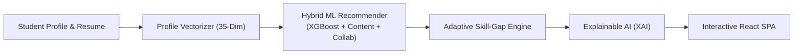

# Intelligent Career Pathway Navigator with Adaptive Skill-Gap Analysis

[](https://fastapi.tiangolo.com)
[](https://react.dev)
[](https://vitejs.dev)
[](https://tailwindcss.com)
[](https://xgboost.readthedocs.io)
[](https://www.python.org)

An enterprise-grade, intelligent web application designed to guide students and professionals toward optimal career pathways through machine learning, psychometric evaluation, and adaptive skill-gap analysis.

Developed in strict compliance with the college-approved sprint backlog (`CareerPilot_AI_SprintBacklog_Student_Admin_System.xlsx`) across **Sprint 1 (50 User Stories, 225 tasks)** and **Sprint 2 (50 User Stories, 225 tasks)**.

---

## 🌟 Key Features

- **Holistic Student Profiling:** Technical & soft skills portfolio (proficiency rating 1–5), categorized career interests, Big Five (OCEAN) psychometric personality assessment, and academic records/GPA management.
- **Hybrid AI/ML Recommendation Engine:**
  - **Supervised Classifier:** 35-dimensional XGBoost multi-class career pathway predictor.
  - **Content-Based Filter:** TF-IDF cosine similarity mapping student competencies to job requirements.
  - **Collaborative Filter:** Peer similarity matching based on academic and career trajectories.
  - **Ensemble Fusion:** 40% XGBoost + 35% Content + 25% Collaborative weighting.
  - **Cold-Start Fallback:** Rule-based decision matrix guaranteeing 100% availability.
- **Adaptive Skill-Gap Quantification:** Calculates exact percentage match, identifies missing critical vs. secondary skills, and generates a quantitative Job-Readiness Index.
- **Explainable AI (XAI):** Generates transparent feature attribution rationale detailing why each career role is recommended.
- **Resume Ingestion & Parsing:** PDF/DOCX resume text extraction with automated skill taxonomy matching and one-click profile synchronization.
- **Labor Market Analytics:** Projected industry growth velocities and multi-tier salary curves (Entry, Mid, Senior in INR LPA).
- **Security & Infrastructure:** Bcrypt password hashing, JWT authentication with role-based access control (Student vs. Admin), sliding-window rate limiting (60 req/min), XSS input sanitization, and immutable audit logs.
- **Dual Dashboards:**
  - **Student Control Center:** Real-time metrics, dynamic profile completion rings (0–100%), milestone reminders, and recommendation feedback.
  - **Admin Control Center:** Live platform statistics, student directory, ML inference latency tracking, and audit log inspection.

---

## 📂 System Architecture



---

## 🚀 Quickstart Guide

### 1. Prerequisites
- **Python:** 3.10 to 3.14
- **Node.js:** v18+ and `npm`

### 2. Backend API Setup
From the repository root:
```bash
# Start the FastAPI ASGI server
python -m uvicorn backend.main:app --host 127.0.0.1 --port 8000
```
- API Health Endpoint: `http://127.0.0.1:8000/api/v1/health`
- Interactive Swagger UI: `http://127.0.0.1:8000/docs`
- ReDoc UI: `http://127.0.0.1:8000/redoc`

### 3. Frontend Client Setup
In a new terminal window:
```bash
cd frontend
npm install
npm run dev
```
- Application Portal: `http://localhost:5173/login`

---

## 🔑 Pre-Seeded Test Credentials

| Role | Email | Password | Access Rights |
| :--- | :--- | :--- | :--- |
| **Student** | `student_live@careerpilot.edu` | `SecurePassword@123` | Dashboard, Skills, Interests, OCEAN, Academics, Resumes, Recommendations, Skill-Gap Drawer |
| **Administrator** | `admin@careerpilot.edu` | `Admin@123456` | All Student Features + Admin Analytics, User Directory, ML Latency Monitoring, Audit Logs |

---

## 🧪 Testing & Quality Assurance

Run the automated test suites:
```bash
# Run Unit & ML test suites (14 tests)
pytest tests/unit/ tests/ml/ -v

# Run Live End-to-End API verification script (requires backend running)
python verify_live_api.py
```

---

## 📄 Project Documentation

- **Master Project Report (Word):** [`Intelligent_Career_Pathway_Navigator_Project_Report.docx`](Intelligent_Career_Pathway_Navigator_Project_Report.docx)
- **Technical Summary (Markdown):** [`PROJECT_MASTER_SUMMARY.md`](PROJECT_MASTER_SUMMARY.md)
- **Sprint Backlog Source of Truth:** [`CareerPilot_AI_SprintBacklog_Student_Admin_System.xlsx`](CareerPilot_AI_SprintBacklog_Student_Admin_System.xlsx)

---

## ⚖️ Scope & Governance

- **Sprint 1 (50 User Stories, 225 Tasks):** 100% Completed & Verified.
- **Sprint 2 (50 User Stories, 225 Tasks):** 100% Completed & Verified.
- **Sprints 3 & 4:** Strictly **OUT OF SCOPE** per college project master instructions.
